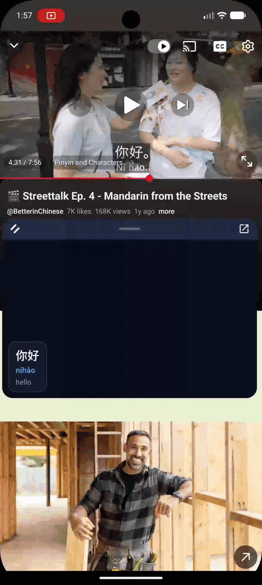
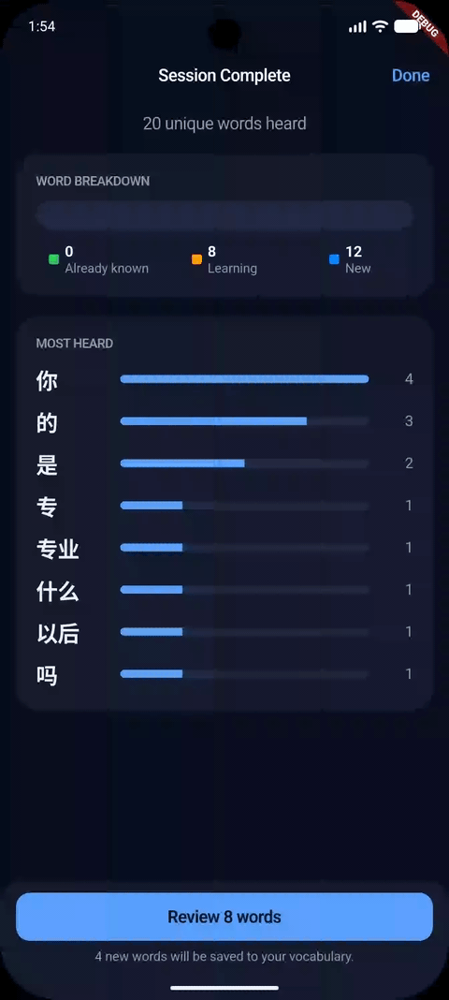
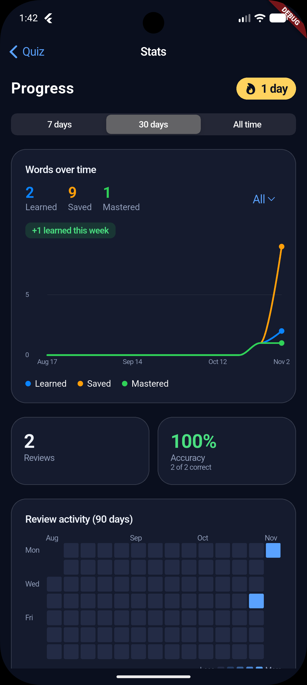
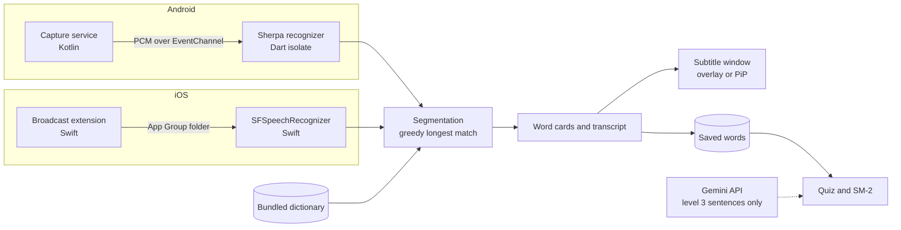

<p align="center">
  
</p>

# SubLearn

Live Mandarin subtitles for the video you are already watching, and a quiz built from the words you tap.

Most Mandarin learners hit the same wall: they can study word lists, but the video they actually want to understand is too fast and has no subtitles they can use. SubLearn listens to audio playing on your phone and shows each word as a card with pinyin and meanings. One tap saves a word. A spaced repetition quiz brings it back until you know it, and the subtitles then stop showing hints for words you have learned.

<table>
  <tr>
    <td width="33%" valign="top"></td>
    <td width="33%" valign="top"></td>
    <td width="33%" valign="top"></td>
  </tr>
  <tr>
    <td align="center"><sub>Live subtitle overlay</sub></td>
    <td align="center"><sub>Quiz</sub></td>
    <td align="center"><sub>Stats</sub></td>
  </tr>
</table>

## What it does

- **Subtitles over any app.** Start Screen Share, play a Mandarin video, and word cards appear in a floating window. The source can be system audio or the microphone.
- **Tap a word to learn it.** Pinyin, English meanings and a character-by-character breakdown, from an offline dictionary of about 105,000 entries.
- **Type, paste or speak.** The Translate tab does the same lookup for text that is not playing as audio.
- **A quiz that adapts.** Words climb three levels as you answer correctly. Each level asks different questions, from multiple choice to listening and fill in the blank. Scheduling uses SM-2.
- **Hints fade as you learn.** Words past level 1 lose their meaning in the subtitles, and past level 2 their pinyin too.
- **Progress you can see.** Streak, accuracy, a words-over-time chart and a 90 day review heatmap.
- **Mostly offline.** Dictionary, speech recognition and scheduling run on the device. The only network call is optional: example sentences for level 3 questions.

The full list, planned work and known limits are in [FEATURES.md](FEATURES.md).

## Why it was hard

Capturing another app's audio is the hard part, and the two platforms disagree about how. Android has no built-in speech recognizer for system audio, so the app runs its own streaming model inside a background isolate. iOS only lets a Broadcast Upload Extension see system audio, and that extension has a memory limit of roughly 50 MB, too small for the same model. The extension passes audio to the app through a shared folder and the app uses Apple's recognizer instead.

The subtitle window is the second problem. Android draws it as a second Flutter engine inside a system overlay that can be dragged and resized. iOS draws it into a Picture in Picture window from native Swift.

## For engineers

### Stack

| Layer | Choice |
| --- | --- |
| App | Flutter, Dart 3.6 or newer, Riverpod, Wind class-string styling on a Cupertino theme |
| Speech | `sherpa_onnx` streaming Paraformer (Mandarin and English) in a Dart isolate on Android and for the Translate microphone. `speech_to_text` as fallback. `SFSpeechRecognizer` for iOS Screen Share |
| Android native | Kotlin: MediaProjection capture service, overlay window, platform channels |
| iOS native | Swift: Broadcast Upload Extension, Picture in Picture renderer, audio clip recorder |
| Data | JSON in SharedPreferences, Gemini key in secure storage, bundled TSV dictionary (3.6 MB) |
| Other | `fl_chart`, `flutter_local_notifications`, `flutter_tts`, Gemini API (optional) |

The repository holds about 10,700 lines of Dart and 3,000 lines of Kotlin and Swift, with about 100 tests.

### Architecture



### Decisions worth a look

- **Plain logic, kept apart.** Mastery rules, SM-2, search, session tracking, stats and reminder planning are pure Dart with no Flutter imports, so they test without a device.
- **One network call.** Gemini writes example sentences for level 3 questions. Pinyin and meanings always come from the local dictionary, and sentences are cached. Without a key, levels 1 and 2 and the listening question still work.
- **Questions fall back.** If a harder question cannot be built for a word (no cached sentence yet, say), the builder drops to an easier type instead of skipping the word.
- **Recognition off the UI thread.** Loading the model and decoding both run in a background isolate.
- **Two-pass mastery.** A word moves up a level after two correct answers in a row, and a miss undoes one pass. The streak also picks which of a level's two question types appears.
- **Ported with a checklist.** The app is a port of a SwiftUI app. Each difference from it is tracked in [PORT_NOTES.md](PORT_NOTES.md) as fixed or deliberate.

### Testing

- `flutter test` runs about 100 tests covering mastery, SM-2, dictionary search and segmentation, stats, reminders, session word tracking, transcript joining, PCM conversion and the Screen Share controller against a fake backend. Two widget tests cover the subtitle window.
- The app has had a full run on Android. The Swift code, the iOS Screen Share flow and iOS reminders have not been run. See Status.

### Status

- **Android** is the main target. Screen Share needs Android 10 or later.
- **iOS** shares the Dart code. Screen Share needs iOS 17 or later and a manual Xcode setup, see [ios_native/README.md](ios_native/README.md).
- **Web and desktop** run the app without Screen Share.
- Tested end to end on Android. The iOS build, including the Swift Screen Share code in `ios_native/`, has not been compiled or run, so expect small fixes on the first iOS build.

## Running it

```bash
flutter pub get
flutter test
flutter run
```

Needs Flutter 3.27 or newer. Platform folders are included. If one is missing, regenerate it with `flutter create --project-name subtitle_learn --platforms=android,ios,web,windows,macos,linux .`.

| Setup | Where |
| --- | --- |
| Android permissions and core library desugaring | Already set in `android/app/src/main/AndroidManifest.xml` and `android/app/build.gradle.kts` |
| iOS microphone and speech keys | Add `NSMicrophoneUsageDescription` and `NSSpeechRecognitionUsageDescription` to `ios/Runner/Info.plist` |
| iOS Screen Share | Follow [ios_native/README.md](ios_native/README.md) |
| Android speech model | Settings > Speech > Offline speech model > Download, once, on Wi-Fi. The model is not bundled |
| Gemini key (optional) | Settings > Quiz. Get a key at aistudio.google.com/apikey |

On Android the first Screen Share start asks for the microphone, then sends you to "Display over other apps". Allow it and start again. Screen audio then shows the system capture prompt.

## Layout

- `lib/models` plain data classes and enums. Quiz types are in `models/quiz`.
- `lib/services` pure logic and platform wrappers, grouped by area.
- `lib/state` Riverpod providers and controllers.
- `lib/data` JSON persistence helpers.
- `lib/ui` screens, one widget per file, grouped by screen. `components` holds shared widgets.
- `android/app/src/main/kotlin` Screen Share capture service, overlay window and the audio bridge.
- `ios_native` Swift for Screen Share. Copied into the Xcode project by hand, not built by Flutter.
- `assets/zh-en.tsv` bundled dictionary.
- `test` unit and widget tests.

Styling uses [Wind](https://github.com/fluttersdk/wind) class strings (`WDiv`, `WText`, `WIcon`, `WButton`). Colour tokens and dark mode live in `lib/ui/theme/wind_theme_data.dart`, shared class strings in `lib/ui/theme/wind_classes.dart`. Text fields, switches, sliders, nav bars, charts and the Android overlay use Cupertino or plain Flutter widgets.

## Port notes

SubLearn is a Flutter port of an earlier SwiftUI app. What was ported and what still differs is tracked in [PORT_NOTES.md](PORT_NOTES.md).

## Credits

Dictionary data: CedPane by ssb22. Pinyin from CC-CEDICT (CC BY-SA) and pypinyin. Level 3 sentences from the Google Gemini API. Some code was written with help from Claude (Anthropic).